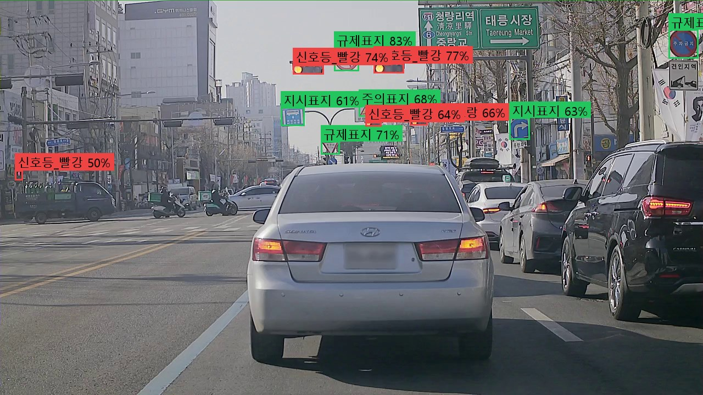
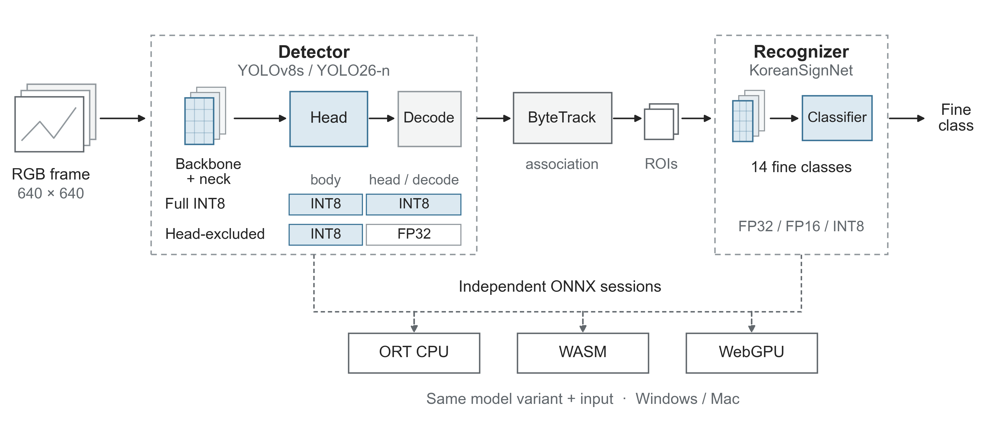
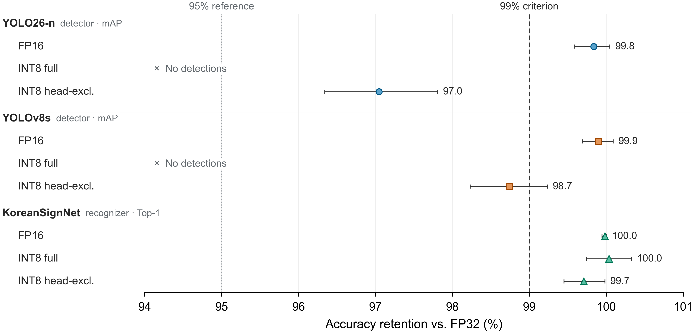
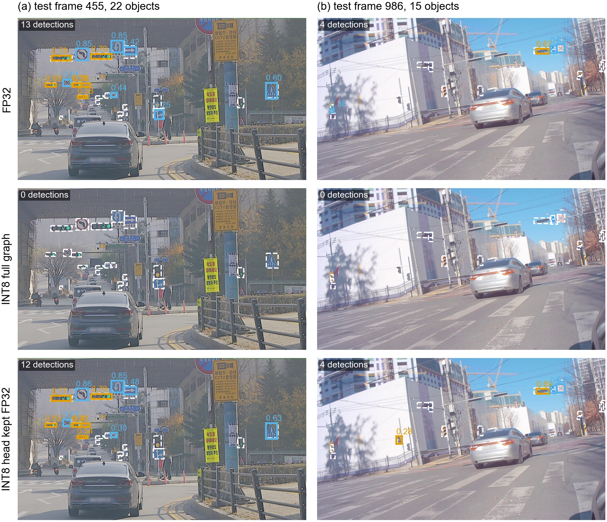
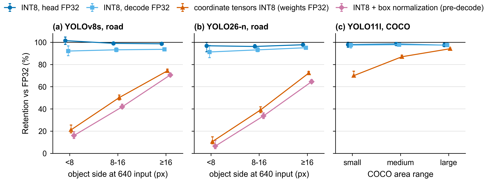
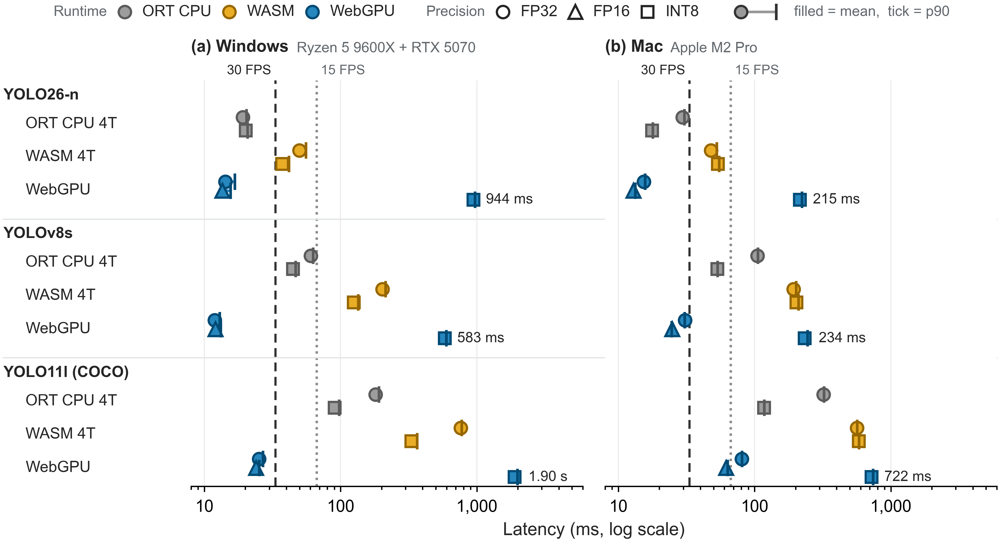
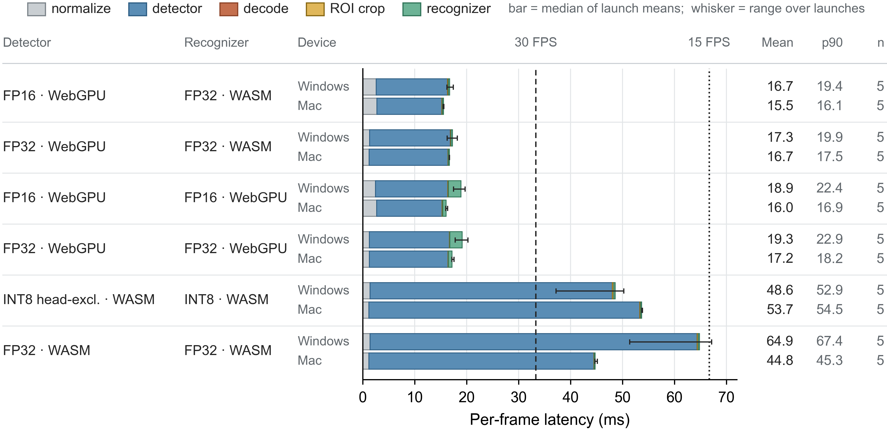

# Edge-Sign

**브라우저에서 실행하는 신호등·교통표지판 인식 파이프라인과, 구성요소·실행 환경별 양자화 효과의 측정**

[웹 데모](https://huggingface.co/spaces/gyann/edge-sign) · [측정 보고서](paper_evidence/reports/RUNTIME_MATRIX.md) · [외부 검증](paper_evidence/reports/COCO_VALIDATION.md) · [평가 기준](paper_evidence/reports/EVALUATION_CRITERIA.md)



<sub>학습에 사용하지 않은 주행 영상의 한 프레임. 교통표지판(녹색)과 신호등(적색)을 검출한 뒤 표지판의 종류와 신호등의 점등 상태를 분류하였다.</sub>

## 1. 개요

Edge-Sign은 도로 주행 영상에서 신호등과 교통표지판을 검출하고, 프레임 사이에서 같은 객체를 추적하며, 표지판의 종류와 신호등의 점등 상태를 분류하는 파이프라인이다. 추론은 서버를 거치지 않고 웹 브라우저 안에서 ONNX Runtime Web으로 수행한다.

이 저장소에는 파이프라인의 구현과 함께, 양자화가 정확도와 지연에 미치는 영향을 측정한 결과가 들어 있다. INT8 양자화는 모델의 크기와 지연을 함께 줄이는 방법으로 널리 쓰이지만, 그 효과는 어느 구성요소를 양자화하는지와 모델을 어디에서 실행하는지에 따라 달라진다. 이를 확인하기 위해 같은 ONNX 파일을 정밀도(FP32, FP16, INT8), 실행 환경(네이티브 CPU, WebAssembly, WebGPU), 기기(Windows 데스크톱, Apple Silicon Mac)를 바꾸어 가며 측정하였다. 주요 결과는 다음과 같다.

1. 검출기 전체를 INT8로 양자화하면 검출 결과가 하나도 출력되지 않는다. 원인은 박스 좌표(0–640)와 클래스 점수(0–1)를 하나의 양자화 척도로 표현하는 디코드 단계의 텐서에 있으며, 이 텐서에서 점수가 모두 0으로 반올림된다.
2. 검출 헤드를 FP32로 남기면 검출은 유지되나 손실이 남는다. FP32 대비 mAP 유지율은 YOLO26-n이 97.0%, YOLOv8s가 98.7%였고, 검출·추적·인식을 모두 거친 종단 정답률의 유지율은 각각 94.2%, 98.3%였다. 파라미터가 약 2.9만 개인 인식기는 전체를 INT8로 양자화해도 정확도가 떨어지지 않았다.
3. INT8의 속도 효과는 실행 환경과 기기에 따라 방향이 바뀐다. Windows에서는 네이티브 CPU와 WebAssembly에서 최대 2.3배 빨라졌으나, WebGPU에서는 양자화 연산이 CPU에서 처리되어 FP32보다 49–89배 느려졌다. Mac의 WebAssembly에서는 INT8이 FP32보다 빠르지 않았다.
4. 검출기를 WebGPU에, 인식기를 WebAssembly에 두는 배치가 두 기기 모두에서 가장 빨랐다. 이때 프레임당 검출·인식 지연의 중앙값은 Windows 16.7 ms, Mac 15.5 ms였다.

https://github.com/user-attachments/assets/5183de0d-e971-4285-9a86-a29306594c08

## 2. 시스템 구성



<sub>그림 1. 파이프라인과 측정 구조. 검출기와 인식기는 서로 독립된 ONNX 세션으로 실행되며, 세션마다 실행 환경을 따로 지정할 수 있다.</sub>

| 구성요소 | 모델 | 설명 |
| :--- | :--- | :--- |
| 검출기 | YOLOv8s (1,120만 파라미터), YOLO26-n (240만) | 640×640 입력에서 교통표지판과 신호등 두 클래스를 검출한다. YOLOv8s는 DFL 헤드와 NMS를 사용하고, YOLO26-n은 NMS 없이 최대 300개의 검출을 직접 출력한다. |
| 추적기 | ByteTrack | 칼만 필터와 IoU 매칭으로 프레임 사이의 검출을 연결한다. 학습 가중치가 없으며, Python 구현과 브라우저용 TypeScript 구현을 함께 둔다. |
| 인식기 | KoreanSignNet (약 2.9만) | 검출 박스를 32×32로 잘라 14개 세부 클래스로 분류한다. 표지판 9종(속도제한 30·40·50·60·70·80, 규제·지시·주의)과 신호등 상태 5종(빨강·초록·노랑·좌회전·기타)이며, 검출 클래스에 따라 분류 후보를 제한한다. |
| 장면 질의 | LLM (Groq API) | 인식 결과를 JSON으로 넘겨 "지금 앞에 어떤 표지판이 있는가"와 같은 질문에 답한다. 사용자가 입력한 API 키로 동작한다. |

웹 데모에서는 검출기(YOLO26-n, YOLOv8s), 정밀도(FP32, FP16, INT8), 실행 환경(WebGPU, WebAssembly)을 화면에서 선택하여 모델 크기와 단계별 지연을 비교할 수 있다. 내장 샘플 영상과 웹캠, H.264 영상은 브라우저가 직접 디코딩하여 기기 안에서 추론한다. 브라우저가 디코딩하지 못하는 코덱의 영상은 서버가 디코딩과 추론을 맡는 경로로 전환되는데, 공개 데모의 서버는 CPU만 사용하므로 재생이 끊길 수 있다. 샘플 영상은 [v1.0.1 릴리스](https://github.com/todayoneul/edge_sign/releases/tag/v1.0.1)에서도 내려받을 수 있다.

## 3. 실험 설계

### 3.1 데이터

AI Hub의 [신호등·도로표지판 인지 영상(수도권)](https://aihub.or.kr/aihubdata/data/view.do?currMenu=115&topMenu=100&dataSetSn=188) 가운데 주행 영상 8개 시퀀스를 사용하였다. 연속한 프레임은 서로 매우 비슷하므로 프레임 단위로 무작위 분할하면 거의 같은 장면이 학습과 평가에 함께 들어간다. 이를 막기 위해 시퀀스 단위로 분할하였고, 분할 사이에 시퀀스 이름과 JPEG 파일의 SHA-256 해시가 겹치지 않음을 확인하였다.

| 분할 | 시퀀스 | 프레임 | 비고 |
| :--- | ---: | ---: | :--- |
| 학습 | 5 | 12,375 | 주간 12,250, 야간 125 |
| 검증 | 1 | 1,903 | 앞쪽 150프레임을 INT8 보정에 사용 |
| 시험 | 2 | 2,417 | 주간 2,401, 야간 16, 객체 6,772개 |

원본 영상과 라벨은 AI Hub 이용약관에 따라 저장소에 포함하지 않았다. 분할 목록과 누수 검사 결과는 [paper_evidence/splits/](paper_evidence/splits/)에 있다.

### 3.2 양자화 설정

INT8 모델은 ONNX Runtime의 정적 양자화(QDQ 형식)로 만들었다. 가중치는 채널별 대칭 INT8, 활성값은 비대칭 UINT8이며 보정에는 MinMax 방식을 사용하였다. 양자화 범위는 그래프 전체를 양자화하는 경우와 마지막 검출 헤드 모듈을 FP32로 남기는 경우(이하 헤드 제외)로 나누었다. 검출기의 보정에는 검증 분할의 150프레임을, 인식기의 보정에는 검증용 ROI 512개를 사용하였으며 어느 쪽도 시험 분할과 겹치지 않는다.

### 3.3 측정 방법

정확도는 검출기의 경우 시험 분할 2,417프레임에서 COCO 방식의 mAP@0.5:0.95로, 인식기의 경우 같은 분할의 정답 박스에서 자른 ROI 6,771개의 Top-1 정확도로 측정하였다. 유지율은 같은 모델의 FP32 결과에 대한 비율이다. 양자화 모델의 합격 기준은 MLPerf Inference의 관례에 따라 유지율 99%로 측정 전에 정하였으며, 신뢰구간은 프레임 단위 부트스트랩 1,000회로 구하였다.

지연은 배치 크기 1에서 예열 20회 뒤 추론 호출 1,024회의 시간을 재어 평균과 p90으로 기록하였다. 모든 실행 환경에 같은 입력 텐서를 주어 전처리의 차이가 결과에 섞이지 않게 하였다.

| 항목 | Windows | Mac |
| :--- | :--- | :--- |
| CPU, GPU | AMD Ryzen 5 9600X, NVIDIA RTX 5070 | Apple M2 Pro |
| 운영체제 | Windows 11 Pro | macOS 26.6.2 |
| 브라우저 | Chrome 153 (headless) | Chrome 153 (headless) |
| 런타임 | ONNX Runtime 1.23.2, ONNX Runtime Web 1.30.0 | 동일 |

## 4. 결과

이 장의 수치는 모두 [측정 보고서](paper_evidence/reports/RUNTIME_MATRIX.md)와 [paper_evidence/](paper_evidence/README.md)의 원시 기록에서 가져왔다.

### 4.1 구성요소별 정확도

| 모델 | 정밀도 | 파일 크기 (MB) | mAP@0.5 | mAP@0.5:0.95 | 유지율 (%) [95% CI] |
| :--- | :--- | ---: | ---: | ---: | :--- |
| YOLO26-n | FP32 | 9.81 | 0.4999 | 0.2422 | 기준 |
| | FP16 | 4.97 | 0.4986 | 0.2418 | 99.84 [99.59–100.05] |
| | INT8 전체 | 3.10 | 0 | 0 | 0 |
| | INT8 헤드 제외 | 3.42 | 0.4826 | 0.2350 | 97.05 [96.34–97.81] |
| YOLOv8s | FP32 | 44.75 | 0.5653 | 0.2808 | 기준 |
| | FP16 | 22.38 | 0.5656 | 0.2805 | 99.90 [99.69–100.09] |
| | INT8 전체 | 11.66 | 0 | 0 | 0 |
| | INT8 헤드 제외 | 18.00 | 0.5585 | 0.2772 | 98.74 [98.23–99.23] |
| KoreanSignNet | FP32 | 0.117 | – | 0.8082 (Top-1) | 기준 |
| | FP16 | 0.060 | – | 0.8080 | 99.98 [99.94–100.00] |
| | INT8 전체 | 0.042 | – | 0.8084 | 100.04 [99.74–100.33] |

전체를 INT8로 양자화한 검출기는 두 모델 모두 시험 분할 전체에서 신뢰도 0.001 이상의 검출을 하나도 출력하지 못하였다. 헤드를 FP32로 남긴 경우 YOLO26-n은 99% 기준에 미달하였고, YOLOv8s는 신뢰구간이 99%를 포함하여 판정을 보류하였다. 인식기는 전체를 INT8로 양자화해도 정확도를 유지하였다.



<sub>그림 2. 구성요소별 FP32 대비 정확도 유지율과 95% 신뢰구간. 파선은 사전에 정한 99% 기준이다.</sub>

### 4.2 검출이 사라지는 원인

전체 INT8에서 검출이 사라지는 현상은 [Moon 등(2025)](https://doi.org/10.1007/s11760-025-04234-0)이 모바일 TFLite 변환에서 먼저 보고하였다. 여기서는 브라우저에서 쓰는 ONNX QDQ 그래프에서 같은 현상을 재현하고, 가중치와 활성값을 따로 양자화하는 실험으로 원인이 되는 텐서를 좁혔다.

| 양자화한 부분 | YOLO26-n 유지율 (%) | YOLOv8s 유지율 (%) |
| :--- | ---: | ---: |
| 가중치 전체 (활성값은 FP32) | 98.80 | 96.34 |
| 활성값 전체 (가중치는 FP32) | 0 | 0 |
| 디코드 단계의 활성값 | 0 | 0 |
| 출력 연결 텐서 1개의 활성값 | 0 | 0 |
| 디코드 단계의 활성값, 원인 텐서는 FP32 | 57.0 | 61.2 |

가중치만 양자화한 모델에서는 검출이 유지되었고, 가중치를 FP32로 되돌린 채 디코드 단계의 활성값만 양자화해도 mAP가 0이 되었다. 디코드 단계의 텐서를 하나씩 양자화해 보면, 단독으로 mAP를 0으로 만드는 텐서는 모두 박스 좌표와 클래스 점수를 함께 담고 있었다. 이 텐서들의 양자화 척도는 2.5–3.7이어서 0과 1 사이의 점수가 모두 영점으로 반올림된다. 점수만 담은 텐서는 척도가 약 0.0036으로, 단독으로 양자화해도 유지율이 99.9%였다. 반대로 원인 텐서만 FP32로 두면 두 검출기 모두 검출을 유지하였다.

보정 방식을 Percentile이나 Entropy로 바꾸어도 전체 INT8의 결과는 달라지지 않았다. 박스 좌표를 0–1 범위로 정규화하는 기존의 대응 방법을 적용하면 검출은 유지되나 유지율이 34–55%에 그쳤다.



<sub>그림 3. YOLO26-n의 정밀도별 검출 결과. 위에서부터 FP32, 전체 INT8, 헤드 제외 INT8이며 흰 점선은 정답 박스이다.</sub>

### 4.3 헤드를 제외한 뒤에 남는 손실

검출 결과를 ByteTrack으로 추적하고 인식기로 분류한 뒤 정답과 대응시켜 종단 정답률을 구하였다. 인식기는 FP32로 고정하였다.

| 검출기 | mAP 유지율 | 종단 정답 수 (FP32 → INT8 헤드 제외) | 종단 유지율 [95% CI] |
| :--- | ---: | ---: | :--- |
| YOLO26-n | 97.0% | 2,541 → 2,393 | 94.2% [92.8–95.7] |
| YOLOv8s | 98.7% | 2,972 → 2,920 | 98.3% [97.2–99.2] |

YOLO26-n에서는 종단 유지율이 mAP 유지율보다 낮았다. 정답과 대응된 객체의 인식 정확도는 거의 같았으므로(86.2% 대 86.5%), 이 손실은 운영 임계값을 넘는 검출과 추적이 줄어든 데서 나온다.

손실이 객체의 크기에 따라 달라지는지도 확인하였다. 가중치를 FP32로 둔 채 박스 좌표를 담은 텐서의 활성값만 양자화하면 손실이 작은 객체에 집중되었다. 640×640 입력에서 한 변이 8픽셀 미만인 객체의 유지율은 YOLOv8s가 21.1%, YOLO26-n이 10.6%였고, 16픽셀 이상인 객체는 각각 74.3%, 72.3%였다. 헤드 전체를 FP32로 남긴 INT8 모델에서는 크기에 따른 차이가 유의하지 않았다.



<sub>그림 4. 객체 크기별 FP32 대비 유지율. (a) YOLOv8s, (b) YOLO26-n, (c) COCO의 YOLO11l.</sub>

### 4.4 실행 환경별 지연

Windows에서 측정한 평균 / p90 지연(ms)이다. INT8은 헤드 제외 모델이며, 인식기의 WebAssembly 값만 1스레드에서 측정하였다. WebGPU의 INT8은 추론 한 번에 약 1초가 걸려 128회만 측정하였다.

| 모델 | 정밀도 | 네이티브 CPU 4스레드 | WebAssembly 4스레드 | WebGPU |
| :--- | :--- | ---: | ---: | ---: |
| YOLO26-n | FP32 | 19.2 / 20.4 | 49.8 / 55.7 | 14.3 / 16.8 |
| | FP16 | 20.0 / 20.9 | 52.0 / 57.9 | 13.6 / 15.6 |
| | INT8 | 20.2 / 20.8 | 37.2 / 41.8 | 943.5 / 970.3 |
| YOLOv8s | FP32 | 60.4 / 63.1 | 203.0 / 214.3 | 11.9 / 13.0 |
| | FP16 | 60.5 / 62.7 | 204.6 / 215.7 | 12.1 / 13.2 |
| | INT8 | 44.7 / 46.7 | 125.1 / 134.7 | 583.3 / 597.1 |
| KoreanSignNet | FP32 | 0.03 / 0.03 | 0.25 / 0.32 | 3.48 / 4.09 |

네이티브 CPU와 WebAssembly에서는 INT8이 YOLOv8s의 지연을 줄였다. WebGPU에서는 반대로 11.9 ms에서 583.3 ms로 늘었다. ONNX Runtime Web의 연산자 배치 기록을 보면 `QuantizeLinear`가 WebGPU에서 지원되지 않아 모든 양자화 지점이 CPU에서 실행되며, 그 결과 계층마다 GPU와 CPU 사이의 전송이 생긴다. 인식기는 연산량보다 호출 비용이 커서 WebGPU보다 WebAssembly에서 빨랐다. FP16은 ONNX Runtime Web 1.22에서 FP32보다 3–4배 느렸으나 1.30에서는 차이가 없어, 정밀도의 효과가 런타임 버전에도 의존함을 확인하였다.

같은 측정을 Mac에서 반복한 결과는 다음과 같다. 값은 YOLO26-n · YOLOv8s 순이다.

| 비교 | Windows | Mac |
| :--- | ---: | ---: |
| WebGPU에서 INT8 지연 ÷ FP32 지연 | 66 · 49 | 14 · 7.6 |
| WebAssembly 4스레드에서 FP32 지연 ÷ INT8 지연 | 1.34 · 1.62 | 0.84 · 0.95 |
| 네이티브 CPU 4스레드에서 FP32 지연 ÷ INT8 지연 | 0.95 · 1.35 | 1.68 · 1.97 |

WebGPU에서 INT8이 느려지는 방향은 두 기기에서 같았다. WebAssembly에서는 방향이 반대여서 Mac에서는 INT8이 FP32보다 느렸고, 이 결과는 배경 부하를 통제한 재측정에서도 모든 회차에서 같았다.



<sub>그림 5. 실행 환경과 기기별 검출기 지연. 막대는 평균, 수염은 p90이며 세로축은 로그 척도이다.</sub>

### 4.5 구성요소별 실행 환경 배치

검출기(YOLO26-n)와 인식기를 각각 다른 실행 환경에 두고 브라우저에서 프레임당 지연을 측정하였다. 값은 브라우저를 5회 새로 띄워 얻은 평균 지연의 중앙값이며 괄호 안은 p90이다(ms).

| 검출기 | 인식기 | Windows | Mac |
| :--- | :--- | ---: | ---: |
| FP16, WebGPU | FP32, WebAssembly | 16.7 (19.4) | 15.5 (16.1) |
| FP32, WebGPU | FP32, WebAssembly | 17.3 (19.9) | 16.7 (17.5) |
| FP16, WebGPU | FP16, WebGPU | 18.9 (22.4) | 16.0 (16.9) |
| FP32, WebGPU | FP32, WebGPU | 19.3 (22.9) | 17.2 (18.2) |
| INT8, WebAssembly | INT8, WebAssembly | 48.6 (52.9) | 53.7 (54.5) |
| FP32, WebAssembly | FP32, WebAssembly | 64.9 (67.4) | 44.8 (45.3) |

검출기를 WebGPU에, 인식기를 WebAssembly에 둔 배치가 두 기기 모두에서 가장 빨랐고, 5회의 측정 모두에서 두 모델을 WebGPU에 둔 배치보다 빨랐다. WebGPU를 쓸 수 없는 경우 Windows에서는 INT8만 15 FPS 기준(p90 66.7 ms 이하)을 충족하였으나 Mac에서는 FP32가 INT8보다 빨랐다. 이 지연은 정규화, 검출, 디코딩, ROI 자르기, 인식 단계의 합이며 추적기, 화면 렌더링, 영상 디코딩은 포함하지 않는다.



<sub>그림 6. 배치별 프레임당 지연과 단계별 구성. A는 Windows, B는 Mac이다.</sub>

### 4.6 외부 검증

도로 데이터에서 얻은 결과가 표준 워크로드에서도 성립하는지 확인하기 위해 YOLO11l과 COCO 2017 검증 집합의 부분집합 1,525장으로 같은 실험을 반복하였다. 예측 다섯 가지와 판정 규칙은 [측정 전에 공개](paper_evidence/reports/COCO_VALIDATION_PLAN.md)하였고, 다섯 가지 모두 재현되었다. 전체 INT8은 검출을 출력하지 못하였고, 헤드 제외 INT8의 유지율은 99.2% [98.4–99.8]였으며, WebGPU에서의 지연은 25.2 ms에서 1,897.5 ms로 늘었다. 자세한 결과는 [COCO_VALIDATION.md](paper_evidence/reports/COCO_VALIDATION.md)에 있다.

## 5. 한계

- 기기 두 대와 Chrome 153에서만 측정하였다. Safari, Firefox, 모바일 기기는 측정하지 않았다.
- 데이터는 같은 수집원에서 나온 시퀀스 독립 분할 하나이다. 시험 분할의 야간 프레임이 16장뿐이어서 야간 성능은 판단할 수 없다.
- 파이프라인 지연에는 추적기, 화면 렌더링, 카메라 입력과 영상 디코딩이 빠져 있다.
- 추적 품질은 객체 식별자의 수동 주석이 없어 평가하지 않았다.
- 프레임 단위 부트스트랩은 같은 시퀀스 안의 프레임 사이 상관을 무시하므로 신뢰구간이 실제보다 좁다.
- Windows의 파이프라인 반복 측정과 Mac의 1차 측정은 배경 부하를 통제하지 않은 상태에서 이루어졌다. 그래서 절대 지연보다 같은 회차 안의 비교를 우선하여 해석하였다.
- Mac의 WebAssembly에서 INT8이 빠르지 않은 원인은 커널별 시간 분해까지만 진행하였다. INT8 행렬 곱 커널이 FP32 커널보다 4–10%만 빠르고 양자화와 역양자화에 드는 시간이 그 이득보다 크다는 점은 확인하였으나, 이것이 ARM에 특유한 현상인지는 확인하지 못하였다([기록](paper_evidence/extra/wasm_int8/README.md)).

## 6. 저장소 구성

```text
src/pipeline/        FastAPI 서버, 검출·추적·인식 파이프라인, 장면 질의
src/track/           ByteTrack, BoT-SORT 구현과 추적 평가
src/detect/          검출기 학습, 데이터 준비, ONNX 내보내기
src/quant/           양자화 실험
web_modern/          React 프런트엔드(브라우저 추론, ByteTrack의 TypeScript 구현)
scripts/             학습, 내보내기, 점검 스크립트
scripts/paper/       정확도 평가, 지연 측정, 그림 생성 스크립트
paper_evidence/      분할 목록, 원시 예측, 지연 기록, 보고서, 그림
tests/               서버와 평가 코드의 테스트
spaces/              Hugging Face Space 설정
docs/EXPERIMENTS.md  초기 단계의 실험 기록
assets/              그림과 데모 영상
logs/, models/       초기 단계의 학습 기록과 모델
scripts/archive/     초기 단계에 쓴 스크립트
```

`src/` 바로 아래의 파일은 8장에서 설명하는 초기 단계의 실험 코드와 모델 정의이다.

## 7. 실행 방법

### 7.1 웹 데모

[Hugging Face Space](https://huggingface.co/spaces/gyann/edge-sign)에서 설치 없이 실행할 수 있다. WebGPU를 지원하는 브라우저를 권장한다.

### 7.2 로컬 실행

모델 파일(`model_space/`)과 클래스 목록(`data/`)은 이 저장소에서 관리하지 않는다. [데모 저장소](https://huggingface.co/spaces/gyann/edge-sign/tree/main)에서 두 폴더를 내려받아 저장소 루트에 둔 뒤 다음을 실행한다. 공개 데모의 [Dockerfile](Dockerfile)과 같은 절차이며, GPU 없이 CPU로 서버를 띄운다.

```bash
pip install -r requirements-hf.txt
(cd web_modern && npm ci && npm run build)
EDGE_SIGN_CPU_ONLY=1 uvicorn src.pipeline.app:app --port 8000
# http://localhost:8000/detection/
```

두 폴더를 둔 상태에서 Docker로 실행할 수도 있다.

```bash
docker build -t edge-sign .
docker run --rm -p 7860:7860 edge-sign
# http://localhost:7860/detection/
```

장면 질의에는 Groq API 키가 필요하다. 화면에서 직접 입력하거나 환경 변수 `GROQ_API_KEY`로 지정한다.

### 7.3 테스트

```bash
pip install -r requirements-dev.txt
pytest --ignore=tests/paper     # 서버와 파이프라인
(cd web_modern && npm test)     # 프런트엔드
```

`tests/paper/`의 평가 코드 테스트에는 `onnx`와 `pillow`가 추가로 필요하다. 학습과 양자화까지 포함한 전체 환경은 `requirements.txt`에 있으며, Windows와 CUDA 환경에서 내보낸 목록이다.

### 7.4 측정 재현

평가와 측정에 쓴 스크립트는 [scripts/paper/](scripts/paper/)에 있다. 원본 데이터와 ONNX 모델은 저장소에 없으므로, 각 스크립트의 `--artifact-root` 인자로 데이터와 모델이 있는 위치를 지정한다. 모델의 SHA-256 해시는 [paper_evidence/models/](paper_evidence/models/)에 기록되어 있다.

| 내용 | 스크립트 |
| :--- | :--- |
| 검출 정확도 | `evaluate_qdq_detection.py` |
| 실행 환경별 지연과 요약 | `runtime_matrix.py`, `summarize_runtime_matrix.py` |
| 종단 정확도 | `evaluate_end_to_end.py` |
| 원인 분리 | `weight_only_ablation.py`, `activation_ablation.py`, `decode_tensor_scan.py` |
| 좌표 정규화, 보정 방식, 객체 크기 | `normalization_baseline.py`, `calibration_robustness.py`, `size_bin_retention.py` |
| 외부 검증 | `coco_validation.py` |

두 번째 기기에서 측정하는 절차는 [DEVICE_MEASUREMENT_GUIDE.md](paper_evidence/reports/DEVICE_MEASUREMENT_GUIDE.md)에 정리하였다.

## 8. 개발 경과

이 프로젝트는 2026년 4월에 시작한 개인 프로젝트이며, 세 단계를 거쳐 현재의 구성이 되었다. 처음에는 분류 모델(ConvNeXtV2-Nano)에서 W8A8 PTQ, W4A16 QAT, SmoothQuant, 1비트 이진화를 비교하였다. 다음으로 GTSDB와 AI Hub 데이터로 검출·추적·인식 파이프라인을 구성하고 단계별 양자화의 영향을 살폈다. 마지막으로 국내 도로 영상에 맞추어 신호등을 별도 클래스로 분리하고 인식기를 다시 학습하였다.

초기 단계의 기록은 [docs/EXPERIMENTS.md](docs/EXPERIMENTS.md)에 남아 있다. 다만 이 기록은 단계마다 평가 데이터와 방법이 달라 4장의 결과와 직접 비교할 수 없으며, 일부 결론은 이후의 측정으로 대체되었다. 예를 들어 초기에 검출기의 INT8 양자화에 손실이 없다고 본 결과는 가중치만 양자화를 모사한 실험에서 나온 것으로, 실제 정적 INT8 모델의 결과는 4.1절과 같다.

## 9. 라이선스

이 저장소는 [AGPL-3.0](LICENSE)으로 배포한다. 검출기의 학습과 내보내기에 AGPL-3.0인 Ultralytics YOLO를 사용하기 때문이다. 이 코드를 네트워크 서비스로 제공하는 경우에는 AGPL-3.0의 조항에 따라 이용자에게 대응하는 소스 코드를 제공해야 한다.

| 구성요소 | 사용 위치 | 라이선스 |
| :--- | :--- | :--- |
| Ultralytics YOLO | 검출기 학습, 추론, ONNX 내보내기 | AGPL-3.0 |
| ByteTrack | `src/track/bytetrack.py`, `web_modern/src/lib/byteTrack.ts` | MIT |
| DeepSORT의 칼만 필터 | `src/track/bytetrack.py` | GPL-3.0 |
| BoT-SORT | `src/track/botsort.py` | MIT |
| SmoothQuant | 초기 단계의 양자화 실험 | MIT |
| ConvNeXt V2, timm | 초기 단계의 분류 백본 | 코드 MIT·Apache-2.0, 사전학습 가중치 일부 CC BY-NC 4.0 |

전체 출처와 라이선스는 [THIRD_PARTY_NOTICES.md](THIRD_PARTY_NOTICES.md)에 정리하였다. AI Hub와 GTSDB 데이터는 각 제공처의 약관을 따르며 저장소에 포함하지 않았다.
